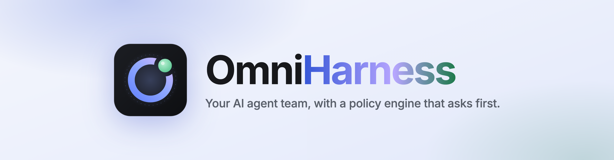
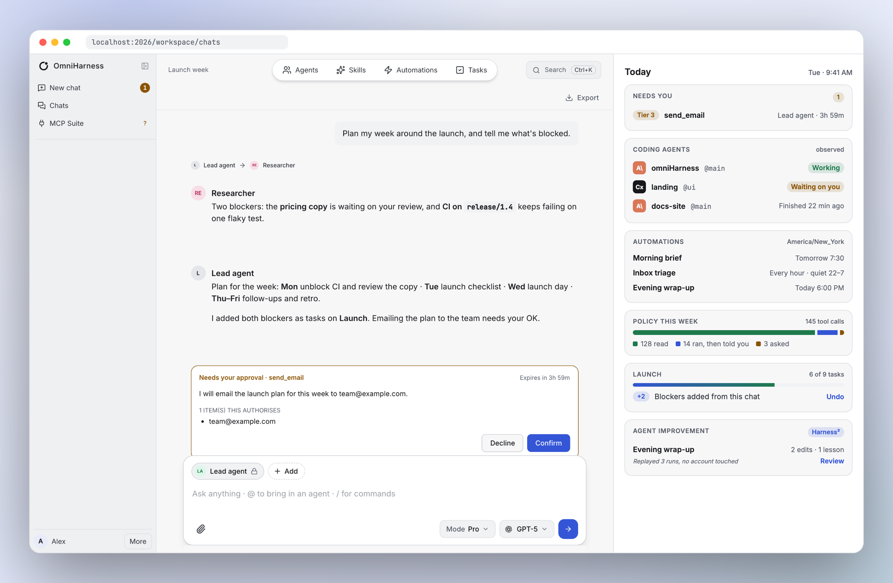
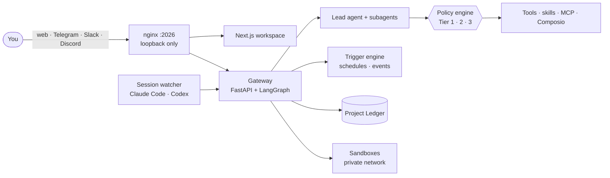
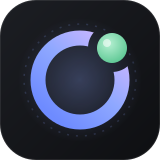

<div align="center">

<a href="https://github.com/archimedes-run/omniHarness">
  <picture>
    <source media="(prefers-color-scheme: dark)" srcset="docs/readme/banner-dark.png">
    
  </picture>
</a>

<h3>The open-source AI agent workspace that asks before it acts.</h3>

<p>
  Chat with a team of agents · automate your week · watch your coding agents · keep every risky action behind a button.
</p>

<p>
  <a href="#-quick-start"><b>Quick start</b></a> ·
  <a href="#-whats-inside">What's inside</a> ·
  <a href="#-in-development">In development</a> ·
  <a href="#%EF%B8%8F-safety-is-the-product">Safety</a> ·
  <a href="#-contributing">Contribute</a>
</p>

[](./LICENSE)
[](./backend/pyproject.toml)
[](./Makefile)
[](https://github.com/langchain-ai/langgraph)
[](#-mcp-suite)
[](#-contributing)

</div>

<br>

<picture>
  <source media="(prefers-color-scheme: dark)" srcset="docs/readme/hero-dark.png">
  
</picture>

<p align="center"><sub>A multi-agent chat in OmniHarness: the researcher finds the blockers, the lead plans the week, and sending email waits for your <b>Confirm</b>. The <i>Today</i> panel on the right previews the dashboards in development; it is an illustrative mock with sample data.</sub></p>

---

## What is OmniHarness?

**OmniHarness** is an open-source, self-hosted **AI agent workspace and agent harness**. You run it on your own machine. It gives you a team of LLM agents that research, plan, write code in sandboxes, work with your mail, calendar and GitHub, and run on a schedule — plus a **policy engine** that decides, for every single tool call, whether an agent may act, must tell you afterwards, or has to ask first.

It is built for people who want an agent that does real work with real accounts, **without** handing it the keys to everything:

- 🧑‍🤝‍🧑 **A team, not a chatbot.** A lead agent hands work to specialist agents (researcher, coder, your own) and you can `@`-mention any of them into a chat.
- 🛡️ **Every tool call is tiered.** Reads run (Tier 1). Reversible writes run and are disclosed with an **Undo** (Tier 2). Anything that sends, deletes, spends or shares waits for **your** button (Tier 3). Tools without an explicit rule are refused, never defaulted.
- 🗓️ **It works while you don't.** Automations fire on a schedule or an event — a morning brief, an inbox triage, an evening wrap-up — in your time zone, respecting quiet hours.
- 👀 **It watches your other agents.** A session watcher follows your **Claude Code** and **Codex** sessions and tells you which one is working, finished, or waiting on you.
- 🔌 **It speaks MCP.** Connect MCP servers and Composio toolkits — and, soon, have the agent **build** a new MCP server for you, sandboxed and approved by its code hash.
- 🏠 **It stays home.** Single owner, loopback-only by default, secrets redacted before anything is stored, and nothing leaves the machine without a rule saying it may.

Built on [LangGraph](https://github.com/langchain-ai/langgraph) and [LangChain](https://github.com/langchain-ai/langchain). Works with OpenAI, Anthropic, Google Gemini, DeepSeek, OpenRouter and self-hosted vLLM models.

---

## ✨ What's inside

<table>
<tr>
<td width="50%" valign="top">

### 💬 Multi-agent chat
Agents carry their own name and colour in the thread, hand-offs read *Lead agent → Researcher*, plans render as real tables and lists, and approval cards sit **inline**, right where the agent asked. Pick a model and skills per chat, attach files, and `@` to bring in an agent.

### 🏠 Home
"Good morning — 3 things need you." Waiting approvals with Decline and Confirm, blocked coding sessions, your projects, the next 7 days of Google Calendar (read-only), and *What moved today* — each line labelled **observed**, **reported** or **inferred**.

### ✅ Tasks and the Project Ledger
Projects, goals, tasks and notes that you and your agents share. Agents propose; routine writes are disclosed with Undo; anything bigger waits for you.

</td>
<td width="50%" valign="top">

### ⚡ Automations
A trigger engine for schedules and events (cron, intervals, calendar, coding-session changes) with quiet hours, time zones, run history, and delivery to the web or Telegram.

### 🛡️ Policy engine
Three tiers decided per call and per argument — inviting people to a calendar event is Tier 3, a private hold is Tier 2. One tool-name normaliser for every source, and a startup check that refuses any tool without an explicit rule. ([tier changes](specs/007-agent-improvement/tier-changes.md))

### 🔌 MCP Suite
Connected MCP servers and Composio toolkits (Gmail, Calendar, Drive, GitHub and more) with live health, tool counts, and *Retry* when a source fails. Failing sources are never hidden.

</td>
</tr>
<tr>
<td valign="top">

### 👀 Coding sessions
Follow every **Claude Code** and **Codex** session on your machine: working, finished, *looks like it's waiting on you*, its own todo list and progress — shown as evidence, never as a claim. ([how it works](#-coding-agents-observed-the-agenttrail-piece))

</td>
<td valign="top">

### 🧰 The harness underneath
Per-thread Docker sandboxes, subagents, long-term memory, hot-loaded **skills**, live preview of web apps the agent builds (it reads the build error and fixes its own code), and channels for **Telegram, Slack, Discord** and OpenClaw.

</td>
</tr>
</table>

---

## 🚧 In development

OmniHarness is built in numbered, spec-driven features ([`specs/`](specs)). Everything below is work in flight. Every safety-relevant piece goes through independent adversarial review rounds before it merges.

| | Feature | Status |
|---|---|---|
| 🔐 | **Security baseline** — one pinned owner at the auth door, server-owned run context, single-use scheduler grants, typed replies only *you* can give, no command execution on the host, sandboxes on a private network, loopback services with Host and Origin guards, an env-key allowlist, lossless 30-day logs | final review |
| 🤝 | **Subagent confirmations** — a subagent's risky call becomes *your* card, the result is posted back as that agent, *Continue &lt;agent&gt;* resumes its own delegation, and it all survives a restart | in review ([#58](https://github.com/archimedes-run/omniHarness/pull/58)) |
| 🎛️ | **Agent Studio and Skill Studio** — build agents and skills with a versioned store and undo, scheduled **autonomy grants** (Tier 2 only, at most 20 actions a run), Apply all, and a run summary with *Undo all* | in review ([#53](https://github.com/archimedes-run/omniHarness/pull/53)) |
| 🧭 | **Agent & Skill Studio redesign** — a four-step stepper for agents (setup with an avatar, configuration, schedule, notifications and review) and skills (details, instructions, files, a saved three-try test); each agent gets exactly the **integrations and tools you tick**, from every MCP server, connected app and built-in, enforced server-side on every run path, each tool showing its real policy tier | in review |
| 🗄️ | **Durable run store** — the full content of every automation run, redacted before it's written, encrypted with **per-run keys** that are destroyed on delete, kept for 30 days | in review ([#55](https://github.com/archimedes-run/omniHarness/pull/55)) |
| 🏗️ | **MCP Build** — the agent writes an MCP server; it's tested in a locked container, you approve it by **code hash**, and it runs behind a Squid egress allowlist with SNI checks; secrets arrive only as read-only files | in review ([#59](https://github.com/archimedes-run/omniHarness/pull/59)) |
| 🧠 | **Agent improvement (Harness²)** — scheduled agents that propose evidence-backed improvements to themselves | specified ([007](https://github.com/archimedes-run/omniHarness/tree/007-agent-improvement/specs/007-agent-improvement)) |
| 📋 | **AI Lists** — tables where an agent researches, enriches or acts on every row, within a budget | specified ([008](https://github.com/archimedes-run/omniHarness/tree/008-ai-lists/specs/008-ai-lists)) |

### 🧠 Agents that improve themselves (the Harness² piece)

Feature **007** adapts **Harness²** ([arXiv:2610.14224](https://arxiv.org/abs/2610.14224), [google-research/harness2](https://github.com/google-research/harness2), Apache-2.0) to a personal workspace with real accounts:

1. **Propose → probe → compose.** For a scheduled agent such as *Evening wrap-up*, OmniHarness replays the agent's own stored runs against its current setup and against *k* candidate setups ("how it works" and "what it knows"). It then composes a proposal from **only the edits the evidence supports**, or says *no change*, which is a normal outcome.
2. **Probes can't write.** Every probe runs behind a wrapper: reads are real, Tier 2 writes are simulated, and Tier 3 never runs. A sabotage test proves that a probe trying a real write fails the gate.
3. **Signals without an answer key.** Execution evidence (as in the paper), **plus** your real feedback history (confirms, declines, edits, dismissals), **plus** honesty checks: a candidate that blurs *observed*, *reported* and *inferred* loses outright.
4. **You approve the diff.** The output is a diff over a versioned agent store — instructions, tool guidance, skills, memory — with a **Lessons** store (the paper's experience library) you can read and edit. Policy tiers, grants and schedules are locked surfaces it can never touch. Nothing applies automatically.

### 👀 Coding agents, observed (the agenttrail piece)

The coding-session watcher (feature 001, extended in 005) borrows ideas from [**sodiumsun/agenttrail**](https://github.com/sodiumsun/agenttrail) (MIT), credited in [THIRD-PARTY-NOTICES](THIRD-PARTY-NOTICES.md):

- a **Codex** adapter alongside Claude Code, reading local session logs (filtered by modification time, not folder);
- **native todo lists** (Claude `TodoWrite` / `TaskCreate`, Codex `update_plan`), applied only after the tool result confirms success;
- optional **Claude Code hooks** as a fidelity upgrade, so *waiting on you* becomes **observed** instead of inferred;
- **declared versus observed scope**, so a session's plan and what it actually touched are never confused.

Sessions feed Home, the Coding sessions page, automations ("tell me when this session finishes") and, next, evidence on Ledger tasks.

---

## 🛡️ Safety is the product

An agent with your credentials is only as good as its guardrails. OmniHarness follows a written [constitution](.specify/memory/constitution.md) and these rules:

| Rule | What it means in practice |
|---|---|
| **Tiered tool calls** | Read → runs. Reversible write → runs, disclosed, undoable. Send, delete, share or spend → your button. A tool with no rule → refused and listed at startup. |
| **Content can't pose as you** | Only messages the server tags as *yours* count as you. Text from mail, web pages, tool output or another agent can never confirm a plan by typing "yes". |
| **Honest status** | *Empty*, *can't tell*, *withheld* and *not set up* are different states, and every line says whether it was **observed**, **reported** or **inferred**. |
| **Secrets stay put** | Known secret values are redacted before anything is stored or shown; built MCP servers get secrets as read-only files; the gateway only receives an allowlist of env keys. |
| **Local by default** | One owner, loopback-only bindings, Host and Origin guards against DNS rebinding, and sandboxes with no host port. |
| **Proven, not promised** | Every check ships with a test through the real app and a **sabotage** run that breaks the check on purpose and watches the test fail. |

---

## 🚀 Quick start

Docker is the supported way to run OmniHarness.

```bash
git clone https://github.com/archimedes-run/omniHarness.git
cd omniHarness
make setup          # choose a model provider; writes config.yaml and .env
make doctor         # check the configuration
make docker-init    # pull the sandbox image
make docker-start   # start the stack
```

Then open **http://localhost:2026** and create the owner account.

You need Docker Desktop (or OrbStack) with Compose v2, about 12 GB of free disk and 8 GB of RAM (16 GB for parallel subagents). The full guide — models, sandboxes, channels, production — is in **[docs/SETUP.md](docs/SETUP.md)**.

<details>
<summary><b>Use it as a Python library</b></summary>

```python
from omniharness.client import OmniHarnessClient

client = OmniHarnessClient()
print(client.chat("Summarise this paper", thread_id="my-thread"))

for event in client.stream("Write a report on quantum computing"):
    if event.type == "messages-tuple" and event.data.get("type") == "ai":
        print(event.data["content"], end="", flush=True)
```

See [`client.py`](backend/packages/harness/omniharness/client.py).
</details>

---

## 🏗️ Architecture



| Path | What lives there |
|---|---|
| [`backend/app/gateway`](backend/app/gateway) | API, auth, routers, run manager |
| [`backend/app/policy`](backend/app/policy) | tiers, rules, confirmations, provenance |
| [`backend/packages/harness`](backend/packages/harness) | the agent harness: agents, tools, sandbox, memory, MCP |
| [`backend/packages/session_watcher`](backend/packages/session_watcher) | Claude Code and Codex observation |
| [`frontend`](frontend) | the workspace UI (Next.js, shadcn/ui, Graphite design tokens) |
| [`specs`](specs) | one folder per feature: spec, plan, research, tasks |

---

## 🤝 Contributing

OmniHarness is young, opinionated and moving fast — a good time to help shape it.

**Good places to start**
- 🏷️ Issues labelled [`review-followup`](https://github.com/archimedes-run/omniHarness/issues?q=is%3Aopen+label%3Areview-followup): well-scoped findings from security reviews, most with a failing test or a clear repro.
- 🔌 New MCP and Composio integrations, with explicit policy rules for their tools.
- 👀 More coding-agent adapters for the session watcher (Cursor, Aider, Gemini CLI…).
- 🎨 UI polish against the Graphite design boards in [`specs/006-workspace-studio/design`](specs/006-workspace-studio/design).
- 📚 Docs, setup notes for Linux and Windows, and translations.

**How we work**
- Each feature starts as a spec in [`specs/`](specs) (Spec Kit) and follows the [constitution](.specify/memory/constitution.md).
- Nothing counts as done until production code calls it; a wiring gate checks that.
- Every new behaviour gets a test through the real app (`create_app()` and its lifespan), and every check gets a **sabotage** run.
- Small commits, one concern each.

```bash
make install                                  # backend (uv) + frontend (pnpm)
make dev                                      # hot reload at http://localhost:2026
cd backend && uv run pytest tests/ -q         # backend tests
cd frontend && pnpm exec vitest run           # frontend unit tests
```

Read [CONTRIBUTING.md](CONTRIBUTING.md) before your first PR. Questions, ideas and design debates are welcome in [Issues](https://github.com/archimedes-run/omniHarness/issues).

---

## ❓ FAQ

<details>
<summary><b>What is OmniHarness, in one sentence?</b></summary>

OmniHarness is an open-source, self-hosted AI agent workspace: a multi-agent harness built on LangGraph, with chat, automations, a coding-session watcher, MCP integrations and a per-call policy engine that keeps risky actions behind your approval.
</details>

<details>
<summary><b>Is OmniHarness local-first? Does my data leave my machine?</b></summary>

It runs on your machine in Docker, binds to localhost and has a single owner. Data leaves only through the model provider you configure and the tools you connect, and anything that sends data off the machine is a Tier 3 action that waits for your button.
</details>

<details>
<summary><b>Which models does it support?</b></summary>

Any OpenAI-compatible model, plus Anthropic, Google Gemini, DeepSeek, OpenRouter and self-hosted vLLM. Long context, reliable tool use and vision help most.
</details>

<details>
<summary><b>How is it different from DeerFlow?</b></summary>

OmniHarness began as a fork of [DeerFlow 2.0](https://github.com/bytedance/deer-flow) (ByteDance, MIT) and keeps its harness, sandbox and gateway roots. It has since become a personal agent *workspace*: the policy engine, multi-agent chat, Home, automations, the Project Ledger, the coding-session watcher, Agent Studio and MCP Build are OmniHarness's own. It is not affiliated with ByteDance.
</details>

<details>
<summary><b>Can it watch Claude Code and Codex?</b></summary>

Yes. The session watcher reads local session logs (read-only) and shows each session's state, todos and whether it's waiting on you — on Home, on the Coding sessions page, and as automation triggers.
</details>

---

## 🙏 Acknowledgements

- [**DeerFlow**](https://github.com/bytedance/deer-flow) by ByteDance — OmniHarness was forked from it. © 2025 Bytedance Ltd. and/or its affiliates; © 2025–2026 DeerFlow Authors ([Daniel Walnut](https://github.com/hetaoBackend/), [Henry Li](https://github.com/magiccube/)). OmniHarness is not affiliated with, sponsored by or endorsed by ByteDance.
- [**agenttrail**](https://github.com/sodiumsun/agenttrail) (MIT) — ideas for observing Codex and Claude Code sessions.
- [**Harness²**](https://github.com/google-research/harness2) (Apache-2.0) — the method behind agent improvement.
- [LangGraph](https://github.com/langchain-ai/langgraph), [LangChain](https://github.com/langchain-ai/langchain), [AIO Sandbox](https://github.com/agent-infra/sandbox), [Next.js](https://nextjs.org/), [shadcn/ui](https://ui.shadcn.com/), [Inter](https://rsms.me/inter/) and [JetBrains Mono](https://www.jetbrains.com/lp/mono/).

## 📄 License

[MIT](./LICENSE). Third-party notices are in [THIRD-PARTY-NOTICES.md](THIRD-PARTY-NOTICES.md).

<div align="center">
<br>

<br>
<sub><b>OmniHarness</b> · open-source AI agent workspace · multi-agent harness · MCP · policy engine · self-hosted</sub>
</div>
